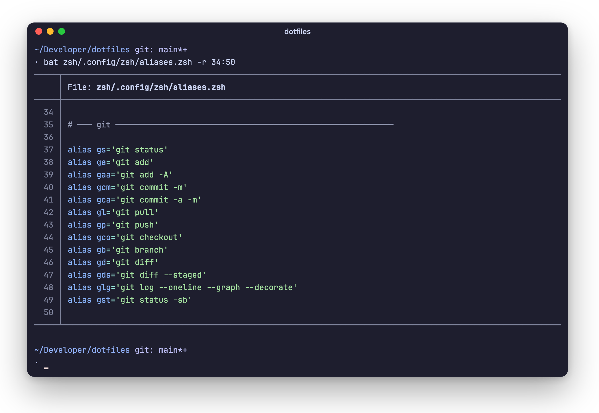

# Bat

[bat](https://github.com/sharkdp/bat) is `cat` with syntax highlighting and
line numbers.

<picture>
  <source media="(prefers-color-scheme: light)" srcset="../assets/bat-light.png">
  
</picture>

It follows macOS appearance: Catppuccin Mocha in dark mode, and the `ansi`
theme in light mode so it picks up Ghostty's Modus Operandi colors.
