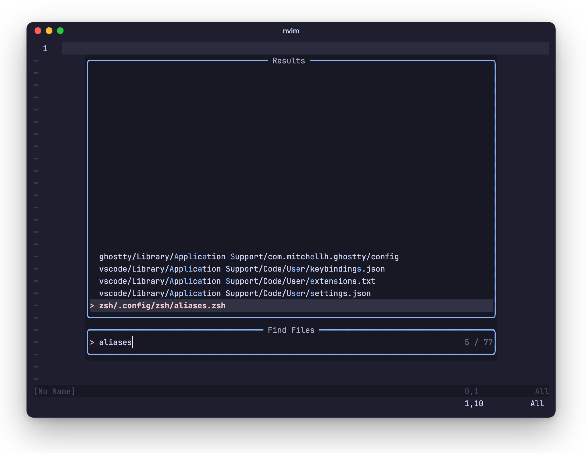
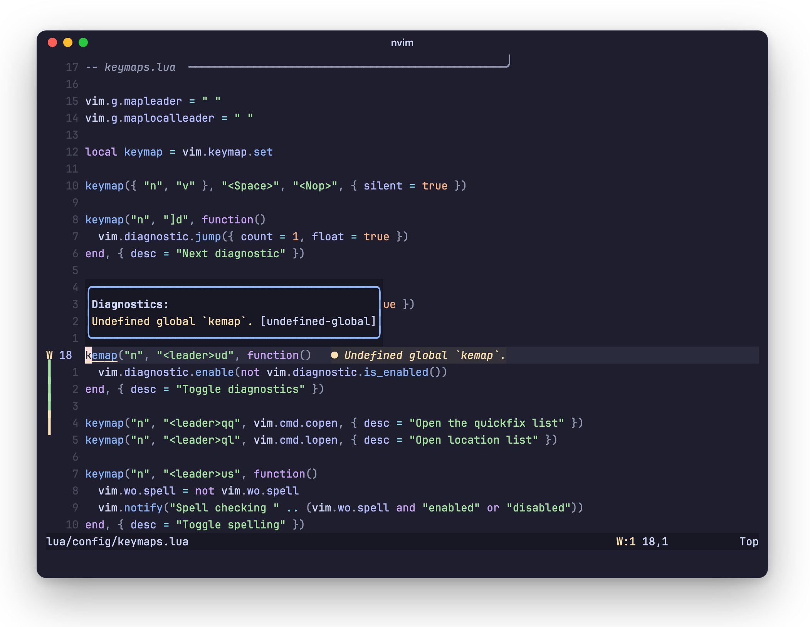
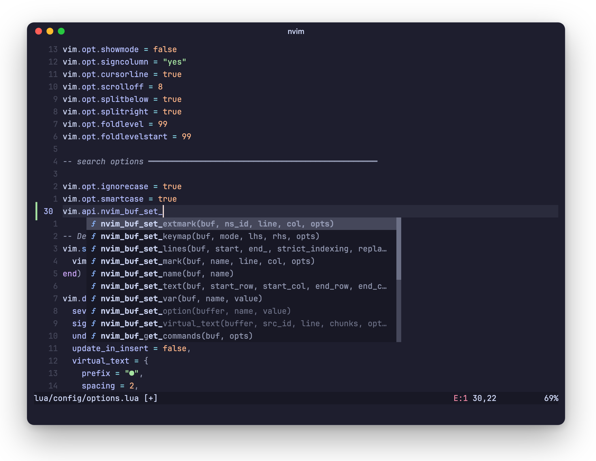
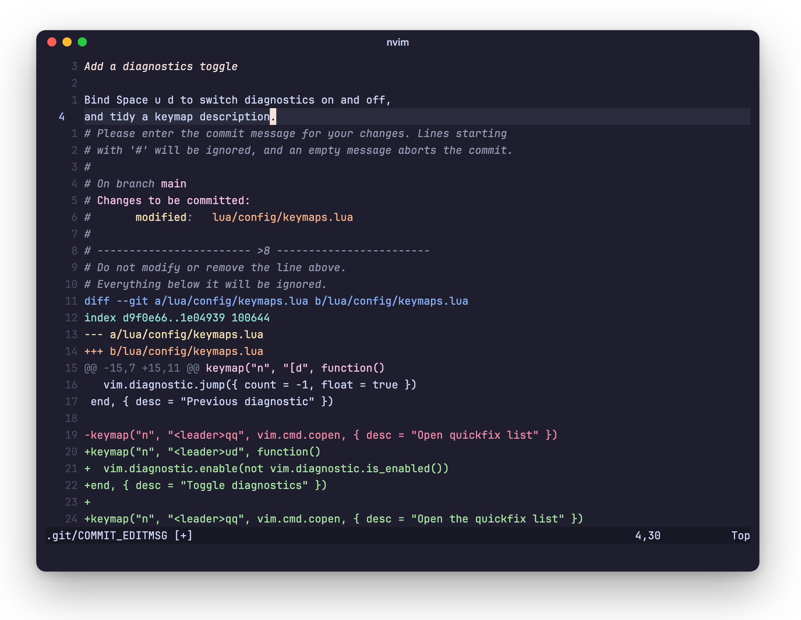

# Nvim

My Neovim config. It's not my main editor, just the thing I reach for to open
a file, fix something quickly, or write a commit message, so it starts fast
and stays small.

- [lazy.nvim](https://github.com/folke/lazy.nvim) for plugins, pinned in
  `lazy-lock.json`
- LSP, completion, Treesitter, Telescope, and gitsigns
- Modus Operandi in light mode, Catppuccin Mocha in dark mode, swapped
  automatically when Ghostty changes theme

The leader is `Space`.

## Jump to a file

`<leader>ff` finds files and `<leader>fg` greps the project. Both include
hidden files, which matters in a repo like this where most config lives under
`.config/`.

<picture>
  <source media="(prefers-color-scheme: light)" srcset="../assets/nvim-find-light.png">
  
</picture>

| Keys | Does |
| --- | --- |
| `<leader>ff` | Find files |
| `<leader>fg` | Grep the project |
| `<leader>fw` | Grep the word under the cursor |
| `<leader>fr` | Recent files |
| `<leader>fb` | Open buffers |
| `<leader>fs` | Symbols in this file |
| `<leader>fd` | Diagnostics |
| `<leader>fh` | Help |

## Fix what the LSP flags

Language servers for Lua, Bash, JSON, PHP, and JavaScript/TypeScript (JSX and
TSX included) install themselves through Mason the first time a file opens. Warnings show at the end of the line, and `]d`
jumps to the next one with the full message. The bar on the left is gitsigns
marking lines that changed since the last commit.

<picture>
  <source media="(prefers-color-scheme: light)" srcset="../assets/nvim-fix-light.png">
  
</picture>

| Keys | Does |
| --- | --- |
| `]d` / `[d` | Next / previous diagnostic |
| `gd` | Go to definition |
| `grr` / `gri` | References / implementations |
| `grn` / `gra` | Rename / code action |
| `K` | Hover docs |
| `<leader>cf` | Format the buffer |
| `<leader>qq` / `<leader>ql` | Quickfix / location list |

Everything except `gd` and `<leader>cf` is a Neovim default.

## Complete as you type

[blink.cmp](https://github.com/saghen/blink.cmp) pulls from the LSP, paths,
snippets, and the buffer. Nothing is picked until you ask, so `Enter` still
makes a new line.

<picture>
  <source media="(prefers-color-scheme: light)" srcset="../assets/nvim-complete-light.png">
  
</picture>

| Keys | Does |
| --- | --- |
| `Ctrl+N` / `Ctrl+P` | Next / previous item |
| `Enter` | Accept the selected item |
| `Ctrl+Space` | Open the menu, or toggle docs |
| `Tab` / `Shift+Tab` | Jump through snippet fields |

## Write commit messages

Git uses Neovim as its editor, with `commit.verbose` on, so the staged diff is
right there under the message.

<picture>
  <source media="(prefers-color-scheme: light)" srcset="../assets/nvim-commit-light.png">
  
</picture>

Hunks can be staged from inside Neovim too:

| Keys | Does |
| --- | --- |
| `]h` / `[h` | Next / previous hunk |
| `<leader>gd` | Preview the hunk |
| `<leader>gg` / `<leader>gz` | Stage / reset the hunk (or the selection) |
| `<leader>gb` | Toggle blame on the current line |
| `<leader>qh` | List the buffer's hunks in quickfix |

## Write prose

`<leader>up` switches the window to prose mode: no line numbers or sign column,
soft wrapping, and spell check. Press it again to put everything back.

| Keys | Does |
| --- | --- |
| `<leader>up` | Toggle prose mode |
| `<leader>us` | Toggle spell check |
| `<leader>uw` | Toggle line wrap |

Plugin keymaps live next to each plugin in `lua/plugins/`. The screenshots
come from `python3 scripts/render-previews.py nvim-`, which runs this config
embedded and draws its screen.
