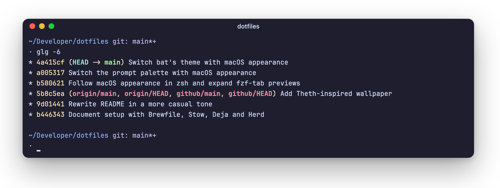

# Oh My Posh

A small two-line prompt for [Oh My Posh](https://ohmyposh.dev): the path and
git branch on top, a `·` to type after.

<picture>
  <source media="(prefers-color-scheme: light)" srcset="../assets/prompt-light.png">
  
</picture>

- `*` means unstaged changes, `+` means staged ones.
- Colors switch with macOS appearance. zsh exports `APPEARANCE` and the config
  picks the `light` or `dark` palette.
- The prompt is skipped in Apple's Terminal.app.
