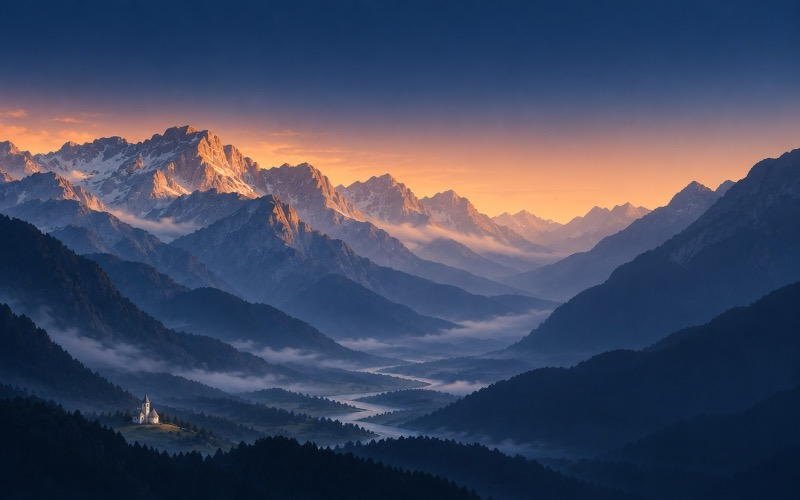
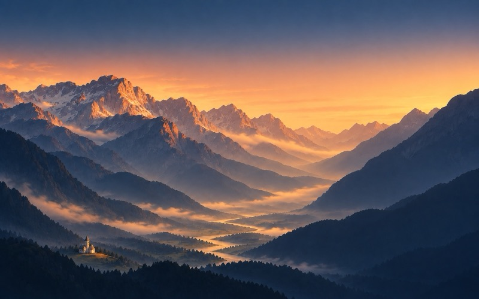
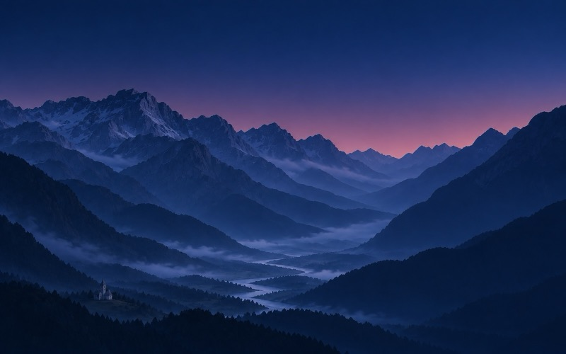

# Wallpaper

A dynamic desktop background inspired by Theth and the Albanian Alps. It
changes through the day as the sun moves, from dawn to dusk.








It's one HEIC file with six frames, each tied to a sun position. macOS works
out where the sun is from your location and switches frames on its own.

After stowing, set it on every display:

```sh
zsh scripts/apply-wallpaper.zsh
```

Run that from the repo root. For every Space, enable System Settings › Wallpaper › Show on all Spaces.
